# Báo cáo Kỹ thuật — Phần Thành viên A: Cấu trúc Hệ thống Tập tin FAT32, Lõi Giải mã (`--info`) và Tình huống Mở rộng (`ext-root`)

> **Phạm vi phụ trách (Thành viên A):**
> - **Lý thuyết (25 điểm):** Chương Cấu trúc hệ thống tập tin FAT32 (chỉ trình bày các trường thực sự sử dụng trong chương trình, kèm công thức ánh xạ địa chỉ và minh chứng hex từ `clean.img`).
> - **Thực hành (15 điểm + tối đa 10 điểm cộng):** Lõi giải mã dùng chung `fat32.py`, chức năng `--info` trong `bai_lam.py`, và tình huống cộng điểm `ext-root` (`mo_rong.json`, `--corrupt`, `--case ext`).

---

## Phần 1. Cấu trúc Hệ thống Tập tin FAT32 và Cơ chế Giải mã Lõi

### 1.1. Bố cục không gian Volume FAT32 và Hệ công thức ánh xạ địa chỉ

Một volume FAT32 (ảnh đĩa bắt đầu tại `base_offset = 0` đối với ảnh volume) được chia thành **3 vùng liên tiếp** theo thứ tự địa chỉ tăng dần:

```mermaid
flowchart LR
    subgraph V1["1. Vùng Dự trữ (Reserved Region)"]
        direction TB
        R0["Sector 0: Boot Sector (BPB)"]
        R1["Sector 1: FSInfo"]
        R6["Sector 6: Backup Boot Sector"]
    end
    subgraph V2["2. Vùng Bảng FAT (FAT Region)"]
        direction TB
        F0["FAT 0 (SF sector)"]
        F1["FAT 1 (SF sector - bản sao)"]
    end
    subgraph V3["3. Vùng Dữ liệu (Data Region)"]
        direction TB
        C2["Cluster 2: Thư mục gốc (RDET)"]
        C3["Cluster 3: Thư mục con DATA (SDET)"]
        CN["Cluster 4 .. MaxCluster: Dữ liệu tập tin"]
    end
    V1 -->|"SB sector"| V2 -->|"NF × SF sector"| V3
```



Từ các tham số đọc được trong Boot Sector (gồm số byte mỗi sector $\text{BytsPerSec}$, số sector mỗi cluster $SC$, số sector vùng dự trữ $SB$, số bảng FAT $NF$, kích thước một bảng FAT $SF$ sector, và tổng số sector của volume $SV$), mọi vị trí vật lý trong chương trình đều được tính động theo hệ công thức sau (với `base_offset = 0` trên ảnh volume):

$$\text{ClusterSize} = \text{BytsPerSec} \times SC \quad \text{(byte)}$$

$$\text{Offset}(\text{FAT}_k) = \text{base\_offset} + (SB + k \cdot SF) \times \text{BytsPerSec} \quad (0 \le k < NF)$$

$$\text{FirstDataSector} = SB + NF \cdot SF$$

$$\text{DataOffset} = \text{base\_offset} + \text{FirstDataSector} \times \text{BytsPerSec}$$

$$\text{Offset}(\text{Cluster } N) = \text{DataOffset} + (N - 2) \cdot \text{ClusterSize} \quad (N \ge 2)$$

$$\text{TotalClusters} = \left\lfloor \frac{SV - \text{FirstDataSector}}{SC} \right\rfloor, \qquad \text{MaxCluster} = \text{TotalClusters} + 1$$

> [!IMPORTANT]
> **Ràng buộc kích thước bảng FAT (dùng để giới hạn miền đọc và kiểm chứng ở TH1):**
> Cụm dữ liệu đầu tiên luôn được đánh số là **Cluster 2** (hai mục `FAT[0]` và `FAT[1]` được dành riêng). Do đó, chỉ số cluster hợp lệ nằm trong đoạn $[2, \text{MaxCluster}]$, và bảng FAT bắt buộc phải đủ chứa ít nhất $\text{TotalClusters} + 2$ mục 4 byte:
> $$\frac{SF \times \text{BytsPerSec}}{4} \ge \text{TotalClusters} + 2$$

**Áp dụng tính toán trên ảnh nguyên vẹn `clean.img` (khớp nhật ký `--info`):**
- $\text{BytsPerSec} = 512$, $SC = 8 \implies \text{ClusterSize} = 512 \times 8 = 4\,096\text{ byte}$ (`0x1000`).
- $SB = 32$, $NF = 2$, $SF = 1\,024$, $SV = 1\,048\,572$:
  - $\text{Offset}(\text{FAT}_0) = 32 \times 512 = 16\,384\text{ byte}$ (`0x00004000`).
  - $\text{Offset}(\text{FAT}_1) = (32 + 1\,024) \times 512 = 540\,672\text{ byte}$ (`0x00084000`).
  - $\text{FirstDataSector} = 32 + 2 \times 1\,024 = 2\,080 \implies \text{DataOffset} = 2\,080 \times 512 = 1\,064\,960\text{ byte}$ (`0x00104000`).
  - $\text{TotalClusters} = \lfloor (1\,048\,572 - 2\,080) / 8 \rfloor = 130\,811 \implies \text{MaxCluster} = 130\,812$ (tổng số mục cần đọc trong bảng FAT là $130\,813$ mục, từ chỉ số `0` đến `130812`).

---

### 1.2. Cấu trúc Boot Sector (BPB) và FSInfo

Theo đúng nguyên tắc thiết kế tối giản, chương trình chỉ giải mã **11 trường trong Boot Sector** và **4 trường trong FSInfo** thực sự tham gia vào việc định vị bố cục, đọc cây thư mục và kiểm chứng phục hồi. Tất cả các số nguyên nhiều byte đều lưu ở định dạng **Little-Endian (LE)**.

#### Bảng 1.1 — Các trường Boot Sector / BPB thực sự sử dụng (Sector 0, bản sao tại `BPB_BkBootSec`)

| Offset | Độ dài | Kiểu | Tên trường (Microsoft / Ký hiệu) | Ý nghĩa và vai trò trực tiếp trong chương trình |
| :--- | :---: | :---: | :--- | :--- |
| `0x0B` | 2 B | `u16` | `BPB_BytsPerSec` | Số byte trên mỗi sector (512). Đơn vị cơ sở để đổi mọi chỉ số sector ra offset byte. |
| `0x0D` | 1 B | `u8` | `BPB_SecPerClus` ($SC$) | Số sector trên mỗi cluster (lũy thừa của 2). Dùng tính `ClusterSize`; **bị làm sai ở TH1**. |
| `0x0E` | 2 B | `u16` | `BPB_RsvdSecCnt` ($SB$) | Số sector của vùng Reserved trước `FAT0`. Dùng tính `Offset(FAT0)`; **bị làm sai ở TH1**. |
| `0x10` | 1 B | `u8` | `BPB_NumFATs` ($NF$) | Số lượng bảng FAT trên volume (thường bằng 2). Dùng tính `FirstDataSector`. |
| `0x13` | 2 B | `u16` | `BPB_TotSec16` ($SV_{16}$) | Tổng số sector 16-bit (bằng `0` trên FAT32; chỉ dùng làm dự phòng nếu `BPB_TotSec32 == 0`). |
| `0x20` | 4 B | `u32` | `BPB_TotSec32` ($SV$) | Tổng số sector của volume. Dùng tính `TotalClusters` và giới hạn biên bảng FAT. |
| `0x24` | 4 B | `u32` | `BPB_FATSz32` ($SF$) | Kích thước một bảng FAT tính bằng sector. Dùng tính `FirstDataSector`; **bị làm sai ở TH1**. |
| `0x2C` | 4 B | `u32` | `BPB_RootClus` | Cluster bắt đầu của thư mục gốc RDET (lấy 28 bit thấp). Điểm xuất phát của `duyet_cay`; **bị làm sai ở `ext-root`**. |
| `0x30` | 2 B | `u16` | `BPB_FSInfo` | Chỉ số sector của cấu trúc FSInfo (thường là sector `1`). Dùng đối chiếu số cluster trống ở TH1. |
| `0x32` | 2 B | `u16` | `BPB_BkBootSec` | Chỉ số sector chứa bản sao Boot Sector (thường là sector `6`). Dùng đối chiếu ở TH1 và `ext-root`. |
| `0x1FE` | 2 B | `u16` | `Signature_word` | Chữ ký kết thúc sector khởi động, giá trị chuẩn `0xAA55` (byte trên đĩa: `55 AA`). |

#### Bảng 1.2 — Các trường FSInfo dùng để kiểm chứng chéo (Sector `BPB_FSInfo`, offset cơ sở `1 × 512 = 0x200`)

| Offset trong FSInfo | Offset tuyệt đối (`clean.img`) | Độ dài | Tên trường | Giá trị chuẩn / Vai trò |
| :--- | :--- | :---: | :--- | :--- |
| `+0x000` | `0x00000200` | 4 B | `FSI_LeadSig` | Chữ ký đầu `0x41615252` (`52 52 61 41` — chuỗi `"RRaA"`), xác nhận sector FSInfo hợp lệ. |
| `+0x1E4` | `0x000003E4` | 4 B | `FSI_StrucSig` | Chữ ký cấu trúc `0x61417272` (`72 72 41 61` — chuỗi `"rrAa"`). |
| `+0x1E8` | `0x000003E8` | 4 B | `FSI_Free_Count` | Số lượng cluster đang trống trên toàn vùng Data (`0xFFFFFFFF` nếu chưa biết). Dùng kiểm chứng chéo $SC, SB, SF$ ở TH1. |
| `+0x1EC` | `0x000003EC` | 4 B | `FSI_Nxt_Free` | Gợi ý cluster trống tiếp theo để cấp phát. |

#### Minh chứng Hex trên `clean.img` — Boot Sector (Sector 0, `offset = 0x00000000`) và FSInfo (Sector 1, `offset = 0x00000200`)

```text
# Boot Sector (Sector 0: offset 0x00000000 .. 0x0000005F và 0x000001F0 .. 0x000001FF)
00000000  EB 58 90 6D 6B 66 73 2E 66 61 74 00 02 08 20 00  .X.mkfs.fat... .
00000010  02 00 00 00 00 F8 00 00 3F 00 20 00 00 00 00 00  ........?. .....
00000020  FC FF 0F 00 00 04 00 00 00 00 00 00 02 00 00 00  ................
00000030  01 00 06 00 00 00 00 00 00 00 00 00 00 00 00 00  ................
00000040  80 00 29 65 E1 13 95 4C 41 42 5F 46 41 54 33 32  ..)e...LAB_FAT32
00000050  20 20 46 41 54 33 32 20 20 20 0E 1F BE 77 7C AC    FAT32   ...w|.
...
000001F0  00 00 00 00 00 00 00 00 00 00 00 00 00 00 55 AA  ..............U.

# FSInfo (Sector 1 = 1 * 512 = 0x00000200)
00000200  52 52 61 41 00 00 00 00 00 00 00 00 00 00 00 00  RRaA............
...
000003E0  00 00 00 00 72 72 41 61 EE FD 01 00 0E 01 00 00  ....rrAa........
000003F0  00 00 00 00 00 00 00 00 00 00 00 00 00 00 55 AA  ..............U.
```

**Giải mã đối chiếu từng byte từ hexdump:**
- `0x0B..0x0C` = `00 02` (LE) $\rightarrow$ `0x0200` = **512** byte/sector (`BPB_BytsPerSec`).
- `0x0D` = `08` $\rightarrow$ **8** sector/cluster (`BPB_SecPerClus`).
- `0x0E..0x0F` = `20 00` (LE) $\rightarrow$ `0x0020` = **32** sector (`BPB_RsvdSecCnt`).
- `0x10` = `02` $\rightarrow$ **2** bảng FAT (`BPB_NumFATs`).
- `0x20..0x23` = `FC FF 0F 00` (LE) $\rightarrow$ `0x000FFFFC` = **1,048,572** sector (`BPB_TotSec32` — lưu ý `mkfs.fat` căn chỉnh theo hình học đĩa nên nhỏ hơn $512\text{ MiB}/512 = 1\,048\,576$ đúng 4 sector; nếu không đọc trường này mà lấy kích thước ảnh chia 512 sẽ lệch miền cluster hợp lệ).
- `0x24..0x27` = `00 04 00 00` (LE) $\rightarrow$ `0x00000400` = **1,024** sector/FAT (`BPB_FATSz32`).
- `0x2C..0x2F` = `02 00 00 00` (LE) $\rightarrow$ Cluster **2** (`BPB_RootClus`).
- `0x30..0x31` = `01 00` $\rightarrow$ Sector **1** (`BPB_FSInfo`); `0x32..0x33` = `06 00` $\rightarrow$ Sector **6** (`BPB_BkBootSec`, nằm tại `6 × 512 = 0x00000C00`).
- `0x1FE..0x1FF` = `55 AA` (LE) $\rightarrow$ `0xAA55` (chữ ký hợp lệ).
- Tại FSInfo `0x03E8..0x03EB` = `EE FD 01 00` (LE) $\rightarrow$ `0x0001FDEE` = **130,542** cluster trống (`FSI_Free_Count`). Trên `clean.img`, tổng số cluster là $130\,811$, số cluster đã cấp phát là $1\text{ (Root)} + 1\text{ (DATA)} + 28 + 85 + 68 + 1 + 85 = 269$ cluster $\implies$ số cluster trống thực tế là $130\,811 - 269 = \mathbf{130\,542}$, khớp chính xác tuyệt đối tới từng đơn vị.

---

### 1.3. Cấu trúc Bảng FAT (File Allocation Table) và Chuỗi Cluster

Bảng FAT là mảng một chiều gồm các số nguyên **4 byte Little-Endian** (`u32`). Phần tử thứ $N$ tại địa chỉ $\text{Offset}(\text{FAT}_k) + 4N$ cho biết trạng thái hoặc chỉ số cluster kế tiếp của cluster $N$.

> [!WARNING]
> **Quy tắc mặt nạ 28-bit bắt buộc:**
> Trong chuẩn Microsoft FAT32, **4 bit cao nhất (bit 28–31)** của mỗi mục FAT được dự trữ (reserved) và có thể mang giá trị khác `0`. Mọi phép đọc mục FAT trong `doc_fat()` đều phải áp mặt nạ `gia_tri & 0x0FFFFFFF` trước khi so sánh hay truy vết chuỗi.

#### Bảng 1.3 — Phân loại giá trị mục FAT32 (sau khi áp mặt nạ `& 0x0FFFFFFF`)

| Giá trị (28-bit) | Ý nghĩa | Cách xử lý trong lõi `fat32.py` |
| :--- | :--- | :--- |
| `0x00000000` | Cluster trống (Free) | Dừng duyệt chuỗi; dùng lọc cluster chưa cấp phát ở TH2, TH3. |
| `0x00000002` – `0x0FFFFFEF` | Cluster kế tiếp đã cấp phát | Nối tiếp vào danh sách cluster nếu nằm trong `[2, MaxCluster]` và chưa thăm. |
| `0x0FFFFFF7` | Cluster hỏng (Bad cluster) | Không chứa dữ liệu hợp lệ; dừng duyệt chuỗi. |
| `0x0FFFFFF8` – `0x0FFFFFFF` | Kết thúc chuỗi (EOC — End of Chain) | Đưa cluster hiện tại vào kết quả rồi kết thúc chuỗi bình thường. |

- **Hai mục đặc biệt đầu bảng (`FAT[0]` và `FAT[1]`):**
  - `FAT[0]` mang byte thấp trùng `BPB_Media` (`0xF8`), sau khi mask là `0x0FFFFFF8`.
  - `FAT[1]` mang dấu EOC (`0x0FFFFFFF`, đôi khi kèm cờ trạng thái ở 4 bit cao).
  - Do đó, 8 byte đầu tiên của mỗi bảng FAT chuẩn `mkfs.fat` có dạng `F8 FF FF 0F FF FF FF 0F` — đây là dấu hiệu nhận dạng để định vị `FAT0` và `FAT1` trong TH1.

#### Minh chứng Hex trên `clean.img` — Bảng `FAT0` (`offset = 32 × 512 = 0x00004000`)

```text
# Đầu bảng FAT0: mục 0..19 (offset 0x00004000 .. 0x0000404F)
00004000  F8 FF FF 0F FF FF FF 0F F8 FF FF 0F FF FF FF 0F  ................
00004010  05 00 00 00 06 00 00 00 07 00 00 00 08 00 00 00  ................

# Vùng mục 28..35 (offset 0x4000 + 28*4 = 0x00004070)
00004070  1D 00 00 00 1E 00 00 00 1F 00 00 00 FF FF FF 0F  ................
00004080  21 00 00 00 22 00 00 00 23 00 00 00 24 00 00 00  !..."...#...$...

# Vùng mục 184..187 (offset 0x4000 + 184*4 = 0x000042E0)
000042E0  FF FF FF 0F FF FF FF 0F BB 00 00 00 BC 00 00 00  ................
```

**Giải mã chuỗi cluster từ hexdump:**
1. `0x4000..0x4007`: `FAT[0] = 0x0FFFFFF8`, `FAT[1] = 0x0FFFFFFF` (2 mục hệ thống).
2. `0x4008..0x400B`: `FAT[2] = 0x0FFFFFF8` (EOC) $\rightarrow$ Thư mục gốc RDET dài đúng 1 cluster: `[2]`.
3. `0x400C..0x400F`: `FAT[3] = 0x0FFFFFFF` (EOC) $\rightarrow$ Thư mục con `DATA` dài đúng 1 cluster: `[3]`.
4. `0x4010..0x407F`: `FAT[4] = 5`, `FAT[5] = 6`, ..., `FAT[30] = 0x1F (31)`, và tại `0x407C` (`0x4000 + 31×4`), `FAT[31] = 0x0FFFFFFF` (EOC) $\rightarrow$ Tập tin `D94.JPG` chiếm đoạn liên tiếp 28 cluster `4..31` (`runs = [[4, 28]]`). Ngay sau đó tại `0x4080` (`FAT[32] = 0x21 = 33`), chuỗi của `Q68.PNG` bắt đầu.
5. `0x42E0..0x42E7`: Tại `0x42E0` (`FAT[184] = EOC` — kết thúc `U58.PDF`); tại `0x42E4` (`0x4000 + 185×4`), `FAT[185] = 0x0FFFFFFF` (EOC ngay lập tức) $\rightarrow$ Tập tin văn bản nhỏ `Z66.TXT` (240 byte) chỉ dài đúng 1 cluster (`runs = [[185, 1]]`); tại `0x42E8` (`FAT[186] = 0xBB = 187`), chuỗi của `F38.JPG` bắt đầu.

---

### 1.4. Cấu trúc Bảng Thư mục (RDET / SDET): Short Entry (8.3) và LFN Entry

Mỗi thư mục (cả gốc RDET lẫn thư mục con SDET) là một dãy các mục **32 byte** nối tiếp nhau nằm trong chuỗi cluster của thư mục đó. Chương trình xử lý đầy đủ cả **Short Entry (8.3)** và **Long File Name (LFN)** để đảm bảo khôi phục đúng 100% tên và đường dẫn tập tin trên cả ảnh nhóm lẫn ảnh ẩn.

#### Bảng 1.4 — Các trường Short Directory Entry (32 byte) thực sự sử dụng

| Offset | Độ dài | Kiểu | Tên trường | Ý nghĩa và quy tắc giải mã trong `doc_thu_muc()` |
| :--- | :---: | :---: | :--- | :--- |
| `0x00` | 11 B | `bytes` | `DIR_Name` | 8 byte tên chính + 3 byte phần mở rộng, đệm khoảng trắng (`0x20`). Byte đầu `0x00`: kết thúc bảng thư mục (dừng quét); `0xE5`: mục đã xóa (bỏ qua); `0x05`: đại diện cho ký tự `0xE5` hợp lệ; `0x2E` (`'.'`): mục `.` hoặc `..`. |
| `0x0B` | 1 B | `u8` | `DIR_Attr` | Thuộc tính: `0x08` (`ATTR_VOLUME_ID` — nhãn đĩa, bỏ qua), `0x10` (`ATTR_DIRECTORY` — thư mục con), `0x20` (`ATTR_ARCHIVE` — tập tin), `0x0F` (`ATTR_LONG_NAME` — mục phụ LFN). |
| `0x0C` | 1 B | `u8` | `DIR_NTRes` | Cờ chữ thường chuẩn Windows NT/Linux: bit `0x08` hạ chữ thường phần tên chính; bit `0x10` hạ chữ thường phần mở rộng (tránh tạo LFN không cần thiết cho tên 8.3 viết thường). |
| `0x14` | 2 B | `u16` | `DIR_FstClusHI` | 16 bit cao của chỉ số cluster đầu tiên; **bị làm sai ở TH2**. |
| `0x1A` | 2 B | `u16` | `DIR_FstClusLO` | 16 bit thấp của chỉ số cluster đầu tiên; **bị làm sai ở TH2**. Chỉ số cluster đầu: `cluster_dau = (HI << 16) | LO`. |
| `0x1C` | 4 B | `u32` | `DIR_FileSize` | Kích thước thật của tập tin tính bằng byte (đối với thư mục luôn bằng `0`). Dùng cắt bỏ vùng dư (slack) ở cluster cuối; **bị làm sai ở `ext-size`**. |

#### Bảng 1.5 — Các trường LFN Entry (32 byte, khi `DIR_Attr & 0x3F == 0x0F`) thực sự sử dụng

| Offset | Độ dài | Kiểu | Tên trường | Ý nghĩa và quy tắc ghép mảnh LFN |
| :--- | :---: | :---: | :--- | :--- |
| `0x00` | 1 B | `u8` | `LDIR_Ord` | Số thứ tự mảnh `seq = Ord & 0x3F` ($1..20$). Bit `0x40` đánh dấu mảnh cuối cùng của tên nhưng **được lưu đầu tiên trên đĩa** (thứ tự giảm dần về `1` ngay trước Short Entry). |
| `0x01`, `0x0E`, `0x1C` | 10+12+4 B | UTF-16LE | `LDIR_Name1..3` | Tổng cộng 26 byte = 13 ký tự UTF-16LE trên mỗi mục LFN; kết thúc bằng `0x0000`, các slot dư đệm `0xFFFF`. |
| `0x0C` | 1 B | `u8` | `LDIR_Type` | Phải bằng `0x00` đối với mục tên dài hợp lệ. |
| `0x0D` | 1 B | `u8` | `LDIR_Chksum` | Checksum 8-bit tính từ 11 byte `DIR_Name` của Short Entry đi ngay sau: $s_i = (((s_{i-1} \ \& \ 1) \ll 7) + (s_{i-1} \gg 1) + b_i) \bmod 256$. Chỉ dùng LFN khi chuỗi mảnh liên tục tới `1` và khớp checksum. |
| `0x1A` | 2 B | `u16` | `LDIR_FstClusLO` | Bắt buộc bằng `0x0000` theo đặc tả Microsoft FAT32. |

> [!NOTE]
> **Phân biệt cấu trúc RDET (Thư mục gốc) và SDET (Thư mục con):**
> - **RDET** không bao giờ chứa hai mục `.` và `..`; mục đầu tiên thường là nhãn đĩa (`DIR_Attr = 0x08`).
> - **SDET** (như thư mục `DATA`) luôn bắt đầu bằng hai mục 32 byte: mục `.` (tại `+0x00`, trỏ về chính cluster đầu của thư mục con đó) và mục `..` (tại `+0x20`, trỏ về thư mục cha; **nếu cha là thư mục gốc RDET thì cluster của `..` luôn được ghi bằng `0`**, bất kể `BPB_RootClus` bằng 2 hay một chỉ số khác). Đặc trưng bất biến này được dùng trực tiếp trong cả TH1 và `ext-root`.

#### Minh chứng Hex trên `clean.img` — RDET (`Cluster 2`, `0x00104000`) và SDET `DATA` (`Cluster 3`, `0x00105000`)

Phép tính offset tuyệt đối:
- $\text{Offset}(\text{Cluster } 2) = 1\,064\,960 + (2 - 2) \times 4\,096 = 1\,064\,960 = \text{0x00104000}$.
- $\text{Offset}(\text{Cluster } 3) = 1\,064\,960 + (3 - 2) \times 4\,096 = 1\,069\,056 = \text{0x00105000}$.

```text
# Thư mục gốc RDET (Cluster 2: offset 0x00104000 .. 0x0010403F)
00104000  4C 41 42 5F 46 41 54 33 32 20 20 08 00 00 22 4D  LAB_FAT32  ..."M
00104010  63 5D 63 5D 00 00 22 4D 63 5D 00 00 00 00 00 00  c]c].."Mc]......
00104020  44 41 54 41 20 20 20 20 20 20 20 10 00 00 22 85  DATA       ...".
00104030  63 5D 63 5D 00 00 22 85 63 5D 03 00 00 00 00 00  c]c]..".c]......

# Thư mục con DATA - SDET (Cluster 3: offset 0x00105000 .. 0x001050DF)
00105000  2E 20 20 20 20 20 20 20 20 20 20 10 00 00 22 85  .          ...".
00105010  63 5D 63 5D 00 00 22 85 63 5D 03 00 00 00 00 00  c]c]..".c]......
00105020  2E 2E 20 20 20 20 20 20 20 20 20 10 00 00 22 85  ..         ...".
00105030  63 5D 63 5D 00 00 22 85 63 5D 00 00 00 00 00 00  c]c]..".c]......
00105040  44 39 34 20 20 20 20 20 4A 50 47 20 00 00 A4 8A  D94     JPG ....
00105050  5C 5D 5C 5D 00 00 A4 8A 5C 5D 04 00 92 B9 01 00  \]\]....\]......
00105060  51 36 38 20 20 20 20 20 50 4E 47 20 00 00 E5 8E  Q68     PNG ....
00105070  5C 5D 5C 5D 00 00 E5 8E 5C 5D 20 00 3C 45 05 00  \]\]....\] .<E..
00105080  55 35 38 20 20 20 20 20 50 44 46 20 00 00 8D 91  U58     PDF ....
00105090  5C 5D 5C 5D 00 00 8D 91 5C 5D 75 00 A9 32 04 00  \]\]....\]u..2..
001050A0  5A 36 36 20 20 20 20 20 54 58 54 20 00 00 B7 93  Z66     TXT ....
001050B0  5C 5D 5C 5D 00 00 B7 93 5C 5D B9 00 F0 00 00 00  \]\]....\]......
001050C0  46 33 38 20 20 20 20 20 4A 50 47 20 00 00 D5 8C  F38     JPG ....
001050D0  5C 5D 5C 5D 00 00 D5 8C 5C 5D BA 00 CE 45 05 00  \]\]....\]...E..
```

**Giải mã từng mục thư mục từ hexdump:**
- **Trong RDET (`0x00104000`):**
  - `0x104000`: Tên `"LAB_FAT32  "`, `DIR_Attr = 0x08` (Volume ID $\rightarrow$ bỏ qua).
  - `0x104020`: Tên `"DATA       "`, `DIR_Attr = 0x10` (thư mục con), `HI = 0x0000`, `LO = 0x0003` $\rightarrow$ `cluster_dau = 3`, `DIR_FileSize = 0`. Byte `0x104040` tiếp theo bằng `0x00` (kết thúc RDET).
- **Trong SDET `DATA` (`0x00105000`):**
  - `0x105000`: Mục `.` (`2E 20 ...`), `Attr = 0x10`, `cluster_dau = 3`.
  - `0x105020`: Mục `..` (`2E 2E ...`), `Attr = 0x10`, `cluster_dau = 0` (xác nhận cha trực tiếp là RDET).
  - Năm tập tin dữ liệu (`Attr = 0x20`, `NTRes = 0x00`):

| Offset Entry | `DIR_Name` $\rightarrow$ Đường dẫn | `HI` (`+0x14`) / `LO` (`+0x1A`) $\rightarrow$ `cluster_dau` | `DIR_FileSize` (`+0x1C` LE) | Số cluster $\lceil \text{size}/4096 \rceil$ | Vùng dữ liệu (Offset đầu) |
| :--- | :--- | :--- | :--- | :---: | :--- |
| `0x00105040` | `DATA/D94.JPG` | `00 00` / `04 00` $\rightarrow$ **4** | `92 B9 01 00` = **113,042 B** | 28 (`4..31`) | `0x00106000` |
| `0x00105060` | `DATA/Q68.PNG` | `00 00` / `20 00` $\rightarrow$ **32** | `3C 45 05 00` = **345,404 B** | 85 (`32..116`) | `0x00122000` |
| `0x00105080` | `DATA/U58.PDF` | `00 00` / `75 00` $\rightarrow$ **117** | `A9 32 04 00` = **275,113 B** | 68 (`117..184`) | `0x00177000` |
| `0x001050A0` | `DATA/Z66.TXT` | `00 00` / `B9 00` $\rightarrow$ **185** | `F0 00 00 00` = **240 B** | 1 (`185`) | `0x001BB000` |
| `0x001050C0` | `DATA/F38.JPG` | `00 00` / `BA 00` $\rightarrow$ **186** | `CE 45 05 00` = **345,550 B** | 85 (`186..270`) | `0x001BC000` |

Khi trích xuất tập tin (hàm `doc_du_lieu`), dữ liệu của chuỗi cluster được đọc gộp theo từng đoạn liên tiếp (`runs`) rồi cắt đúng `DIR_FileSize` byte đầu tiên để loại bỏ phần byte dư (slack space) ở cuối cluster cuối cùng — đảm bảo mã băm SHA-256 khớp tuyệt đối với bản gốc.

---

### 1.5. Kiến trúc Lõi `fat32.py` và Giả mã Chức năng `--info`

#### Thiết kế tách biệt tham số (`ThamSo`) dùng chung cho cả 4 thành viên
Toàn bộ các hàm trong `fat32.py` **không bao giờ tự đọc lại Boot Sector bên trong**, mà nhận đầu vào là một đối tượng `ThamSo(bps, sc, sb, nf, sf, root_clus, tot_sec, base_offset)`. Thiết kế này tạo kiến trúc hình "nan quạt":
- `--info` gọi `doc_bpb(img)` để dựng `ThamSo` trực tiếp từ Sector 0.
- `TH1` suy luận lại `(sc, sb, sf)`, khởi tạo `ThamSo` mới rồi tái sử dụng nguyên vẹn `doc_fat`, `duyet_cay`, `doc_du_lieu`.
- `TH2` dùng `doc_bpb`, `doc_fat`, `doc_thu_muc` (nhận `offset_entry` và `cluster_dau` thô chưa chỉnh sửa) để ghép chuỗi mồ côi.
- `TH3` ghép danh sách cluster của 2 mảnh JPEG rồi truyền thẳng vào `doc_du_lieu(img, ts, cac_cluster, kich_thuoc)`.
- `ext-root` khôi phục `root_clus`, thay thế vào `ThamSo` rồi gọi `trich_xuat_tat_ca`.

#### Giả mã giải mã Volume FAT32 (`--info` và lõi dùng chung)

```text
THUẬT TOÁN: Giải mã cấu trúc Volume FAT32 và liệt kê cây thư mục (--info)
Đầu vào : Ảnh đĩa mở chỉ đọc `img`
Đầu ra  : Từ điển tham số volume + danh sách tập tin `files`, cùng nhật ký kèm offset

1. Hàm DOC_BPB(img, base_offset = 0):
     Kiểm tra u16(base_offset + 0x1FE) == 0xAA55 (cảnh báo nếu khác)
     Đọc bps = u16(+0x0B), sc = u8(+0x0D), sb = u16(+0x0E), nf = u8(+0x10)
     Đọc tot_sec = u32(+0x20) (nếu bằng 0 thì lấy u16(+0x13))
     Đọc sf = u32(+0x24), root_clus = u32(+0x2C) & 0x0FFFFFFF
     Ghi nhật ký từng trường kèm offset tuyệt đối
     Trả về ThamSo(bps, sc, sb, nf, sf, root_clus, tot_sec, base_offset)

2. Hàm DOC_FAT(img, ts, k = 0):
     off = ts.off_fat(k); n_slots = (ts.sf * ts.bps) // 4
     Giải nén một lần mảng <n_slots> số u32 Little-Endian từ img.doc(off, n_slots * 4)
     gioi_han = min(n_slots, ts.max_cluster + 1, so_cluster_toi_da_theo_kich_thuoc_file + 1)
     Trả về [v & 0x0FFFFFFF cho mọi v trong raw_vals[0 : gioi_han]]

3. Hàm CHUOI(fat, dau):
     ket_qua = []; da_tham = tập_rỗng; c = dau
     Trong khi (2 <= c < len(fat)) và (c không thuộc da_tham):
         nxt = fat[c] & 0x0FFFFFFF
         Nếu nxt == 0 hoặc nxt == 0x0FFFFFF7: dừng vòng lặp
         Thêm c vào ket_qua và da_tham
         Nếu nxt >= 0x0FFFFFF8 hoặc nxt < 2 hoặc nxt > 0x0FFFFFEF: dừng vòng lặp
         c = nxt
     Trả về ket_qua

4. Hàm DUYET_CAY(img, ts, fat):
     Khởi tạo tap_tin = [], da_tham_dir = tập_rỗng
     Đệ quy DUYET(clus_dau, tien_to):
         Nếu clus_dau < 2 hoặc clus_dau thuộc da_tham_dir: quay lui
         Đánh dấu clus_dau vào da_tham_dir
         cac_clus = CHUOI(fat, clus_dau)
         Duyệt tuần tự từng slot 32 byte qua các cluster trong cac_clus:
             - Byte đầu 0x00: kết thúc thư mục hiện tại
             - Byte đầu 0xE5: bỏ qua và xóa bộ đệm LFN đang gom dở
             - Attr == 0x0F: kiểm tra thứ tự mảnh & checksum, trích 13 ký tự UTF-16LE vào bộ đệm LFN
             - Attr != 0x0F:
                 + Bỏ qua nếu là Volume ID (Attr & 0x08) hoặc '.' / '..'
                 + Nếu bộ đệm LFN hoàn chỉnh (về mảnh 1) và khớp checksum 11 byte tên ngắn:
                       ten = nối đảo ngược các mảnh LFN
                   Ngược lại:
                       ten = giải mã 8.3 (xử lý 0x05 -> 0xE5, cắt khoảng trắng, áp cờ chữ thường NTRes 0x0C)
                 + Đọc cluster_dau = (u16(+0x14) << 16) | u16(+0x1A), size = u32(+0x1C)
                 + duong_dan = tien_to + "/" + ten (hoặc ten nếu ở gốc)
                 + Nếu (Attr & 0x10): gọi đệ quy DUYET(cluster_dau, duong_dan)
                   Ngược lại: thêm (duong_dan, Entry) vào tap_tin
     Gọi DUYET(ts.root_clus, "")
     Trả về tap_tin
```

---

## Phần 2. Tình huống Mở rộng (Cộng điểm): Sai Con trỏ Thư mục Gốc (`ext-root`)

*(Mục này trình bày phần cộng điểm do Thành viên A cài đặt với đặc tả `mo_rong.json`, hàm `corrupt()` và `case_ext()` trong `bai_lam.py`).*

### 2.1. Đặc tả làm hỏng (`--corrupt mo_rong.json`)

- **Vùng siêu dữ liệu tác động:** Trường `BPB_RootClus` (4 byte tại offset `+0x2C`) ở cả **Boot Sector chính** (Sector 0, `offset = 0x0000002C`) và **Backup Boot Sector** (Sector `BPB_BkBootSec`, trên ảnh chuẩn là Sector 6, `offset = 6 × 512 + 0x2C = 0x00000C2C`).
- **Cơ chế an toàn:** Chương trình gọi `img.sao_chep(anh_hong)` để tạo bản sao độc lập, ghi giá trị sai (`0`) vào đúng hai trường 4 byte trên và xuất danh sách thay đổi ra `<anh_hong>.changes.json` (`[{"offset": 44, "length": 4, ...}, {"offset": 3116, "length": 4, ...}]`). Toàn bộ bảng FAT, bảng thư mục và vùng dữ liệu tập tin được giữ nguyên vẹn 100%.

### 2.2. Chẩn đoán lỗi

Khi đọc ảnh bị hỏng `ext-root`:
1. Các tham số bố cục trong BPB (`BPB_BytsPerSec = 512`, `SC = 8`, `SB = 32`, `NF = 2`, `SF = 1024`, `SV = 1048572`) vẫn hợp lệ và nhất quán.
2. Tuy nhiên, tại offset `0x2C`, `BPB_RootClus` mang giá trị `0` (ngoài miền cluster hợp lệ $[2, 130812]$), và tại bản sao Sector 6 (`offset = 0x0C2C`), `BPB_RootClus` cũng bị ghi `0`. Ngay cả trên ảnh ẩn mà `BPB_RootClus` bị ghi thành một số $\ge 2$ (ví dụ trỏ nhầm vào một tập tin JPEG hoặc trỏ nhầm vào thư mục con `DATA`), việc kiểm tra cấu trúc bảng thư mục gốc `kiem_tra_ung_vien_root()` sẽ phát hiện ngay bất thường và bác bỏ giá trị hỏng này.

```text
# Minh chứng Hex trên ảnh hỏng ext-root tại offset 0x00000020 và 0x00000C20:
# Byte 0x2C..0x2F (và 0xC2C..0xC2F) bị đổi từ `02 00 00 00` thành `00 00 00 00`
00000020  FC FF 0F 00 00 04 00 00 00 00 00 00 00 00 00 00  ................
00000030  01 00 06 00 00 00 00 00 00 00 00 00 00 00 00 00  ................

00000C20  FC FF 0F 00 00 04 00 00 00 00 00 00 00 00 00 00  ................
00000C30  01 00 06 00 00 00 00 00 00 00 00 00 00 00 00 00  ................
```

### 2.3. Cơ sở lý thuyết khôi phục tổng quát (Không giả định `RootClus == 2`)

Do bảng FAT và vùng Data còn nguyên vẹn, cluster bắt đầu thực sự $R$ của thư mục gốc RDET bắt buộc phải là một **đầu chuỗi đã cấp phát** trong bảng FAT:

$$\text{Heads} = \bigl\{\, c \in [2, \text{MaxCluster}] \;\big|\; \text{FAT}[c] \notin \{0, \text{BAD}\} \,\bigr\} \;\setminus\; \bigl\{\, \text{FAT}[x] \;\big|\; x \in [2, \text{MaxCluster}],\; 2 \le \text{FAT}[x] \le \text{MaxCluster} \,\bigr\}$$

Để phân biệt duy nhất RDET ($R$) với mọi thư mục con (SDET) và mọi tập tin dữ liệu trong tập $\text{Heads}$ (kể cả khi trên ảnh ẩn $R \ne 2$), chương trình dựa trên **4 bất biến cấu trúc của FAT32**:
1. **Loại trừ mọi thư mục con (SDET):** Đầu cluster của mọi SDET luôn bắt đầu bằng hai mục `.` (`+0x00`) và `..` (`+0x20`) có `DIR_Attr & 0x10 != 0`. RDET **không bao giờ** có `.` và `..`.
2. **Loại trừ tập tin dữ liệu (JPEG, PNG, PDF, TXT...):** Mọi slot 32 byte trước byte kết thúc `0x00` trong chuỗi cluster của $R$ phải tuân thủ nghiêm ngặt định dạng entry FAT32: mục LFN phải có `LDIR_Type == 0`, `LDIR_FstClusLO == 0`, thứ tự $1..20$; Short Entry phải có 2 bit cao dự trữ `DIR_Attr & 0xC0 == 0` và 11 byte `DIR_Name` không chứa byte điều khiển hay ký tự cấm (`"*+,./:;<=>?[\]|`).
3. **Đối chiếu liên kết con với bảng FAT:**
   - Nếu mục con là tập tin (`size > 0`): `cluster_dau` phải thuộc $\text{Heads}$ và độ dài chuỗi `len(chuoi(fat, cluster_dau))` phải bằng đúng $\lceil \text{size} / \text{ClusterSize} \rceil$.
   - Nếu mục con là thư mục con trực tiếp của gốc (`DIR_Attr & 0x10`): `size == 0`, `cluster_dau` thuộc $\text{Heads}$, và tại đầu `cluster_dau` phải có mục `.` bằng `cluster_dau` kèm **mục `..` có `cluster_dau == 0`** (quy ước đặc trưng duy nhất cho con trực tiếp của RDET theo đặc tả Microsoft FAT32).
4. **Nguồn dư thừa phụ:** Nếu `BPB_BkBootSec` trên ảnh ẩn không bị làm hỏng, ứng viên vượt qua kiểm tra cấu trúc và trùng khớp với `Backup Boot Sector` được cộng thêm điểm ưu tiên đối chiếu.

### 2.4. Giả mã khôi phục (`--case ext`), Hạn chế và Đối chiếu Nhật ký

```text
THUẬT TOÁN: Khôi phục con trỏ thư mục gốc BPB_RootClus (case_ext)
Đầu vào : Ảnh đĩa bị hỏng `img`, thư mục xuất `out`
Đầu ra  : Toàn bộ tập tin trên volume được trích xuất nguyên vẹn

1. ts = DOC_BPB(img); fat = DOC_FAT(img, ts, 0)
2. Đọc tham khảo root_bk tại sector ts.bkboot_sec (+0x2C) nếu chữ ký 0xAA55 hợp lệ
3. cac_dau_chuoi = TIM_CAC_DAU_CHUOI(fat)
4. Chẩn đoán ts.root_clus hiện tại và ghi nhật ký lý do không hợp lệ
5. Với mỗi ứng viên c trong cac_dau_chuoi:
       Kiểm tra 4 bất biến cấu trúc RDET trên chuỗi CHUOI(fat, c)
       Nếu hợp lệ: tính điểm theo số thư mục con có '..'==0 (+50), tập tin khớp chuỗi FAT (+25),
                   Volume Label (+10), vùng trống sạch sau 0x00 (+5), khớp root_bk (+5)
6. Chọn root_dung có điểm cao nhất; ghi nhật ký quyet_dinh kèm offset và lý do
7. Cập nhật ts.root_clus = root_dung và gọi TRICH_XUAT_TAT_CA(img, ts, fat, out)
```

- **Độ phức tạp & Hiệu năng:** Quét bảng FAT một lượt tốn $O(\text{MaxCluster})$ (~9 ms cho 130,813 mục); số đầu chuỗi $|\text{Heads}|$ bằng đúng tổng số thư mục và tập tin trên đĩa (trên ảnh đề bài chỉ có 7 đầu chuỗi: `[2, 3, 4, 32, 117, 185, 186]`), nên toàn bộ quá trình chẩn đoán và trích xuất hoàn tất trong **~36 ms**.
- **Hạn chế:** Thuật toán yêu cầu thư mục gốc có ít nhất một tập tin hoặc thư mục con hợp lệ (nếu volume hoàn toàn rỗng — chưa từng tạo tập tin hay thư mục con nào và cũng không có Volume Label — cluster của RDET sẽ chứa toàn byte `0x00` nên không phân biệt được bằng nội dung nếu cả hai bản Boot Sector đều bị xóa). Với bộ dữ liệu thực tế chứa cây thư mục và tập tin, thuật toán định vị chính xác duy nhất RDET.
- **Đối chiếu khớp Nhật ký chạy thực tế (`--case ext`):**
  - `offset = 0x2c`, `gia_tri = 0`: Chẩn đoán `BPB_RootClus = 0` ngoài phạm vi cluster hợp lệ; bản sao tại `offset = 0xc2c` cũng bằng `0`.
  - `offset = 0x4000`: Tìm thấy 7 đầu chuỗi `[2, 3, 4, 32, 117, 185, 186]`. Trong đó `3` bị loại ngay vì bắt đầu bằng `.` và `..`; `4, 32, 117, 185, 186` bị loại ngay ở slot đầu tiên vì là dữ liệu tập tin; duy nhất **cluster `2` (`offset = 0x104000`)** hợp lệ với điểm `65` (có Volume Label `LAB_FAT32` và 1 thư mục con trực tiếp `DATA` có `.. = 0`).
  - Khôi phục `BPB_RootClus = 2` và trích xuất đủ 5/5 tập tin khớp 100% mã băm SHA-256 gốc.
