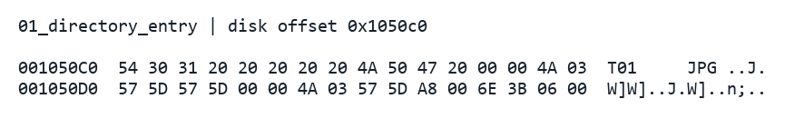
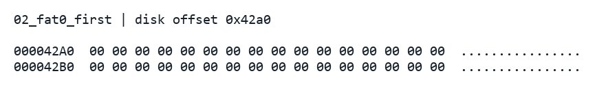
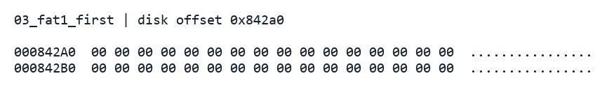
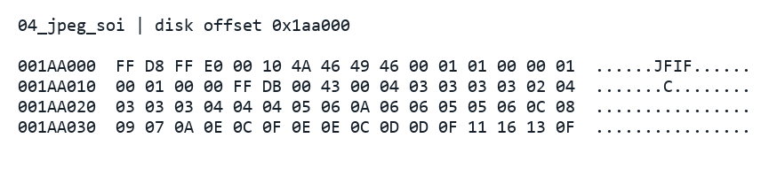
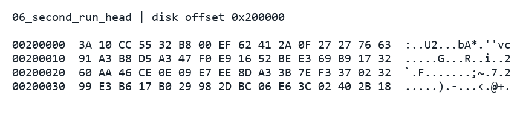
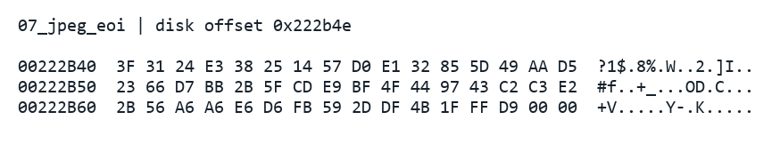

# Tình huống 3 - Phục hồi JPEG có chuỗi FAT bị xóa

## 1. Phạm vi và chẩn đoán

Theo đề FAT32, chuỗi FAT của JPEG mục tiêu bị ghi 0 trên cả hai bảng; directory entry vẫn giữ cluster đầu và kích thước. Dữ liệu có hai mảnh, mỗi mảnh liên tục; mảnh thứ hai nằm sau mảnh thứ nhất trong phạm vi 64 cluster. Không thể lần theo FAT để khôi phục vị trí mảnh sau.

Từ lõi FAT32, đọc BPB và cây thư mục. Với mỗi short entry, lấy `DIR_FstClusHI` tại entry + `0x14`, `DIR_FstClusLO` tại entry + `0x1A`, `DIR_FileSize` tại entry + `0x1C`. Cluster đầu là `((HI << 16) | LO) & 0x0FFFFFFF`. JPEG mục tiêu có size khác 0, cluster đầu hợp lệ, mọi bản FAT tại cluster đầu bằng 0, và dữ liệu bắt đầu bằng SOI `FF D8`.

Chương trình yêu cầu đúng một JPEG mục tiêu. Chuỗi thư mục và các tệp khác phải nguyên vẹn. Các cluster của chúng được đánh dấu để không lấy nhầm khi ghép.

## 2. Cơ sở lý thuyết

Với `B = BPB_BytsPerSec`, `S = BPB_SecPerClus`, `R = BPB_RsvdSecCnt`, `F = BPB_FATSz32`, `N = BPB_NumFATs`:

```text
C = B * S
data_offset = (R + N * F) * B
offset(cluster c) = data_offset + (c - 2) * C
offset(FAT k, entry c) = (R + k * F) * B + 4 * c
n = ceil(file_size / C)
```

`n - 1` cluster nằm sau cluster đầu, nhưng độ dài toàn run đầu chưa biết. Với cluster đầu `a`, thử độ dài run đầu `p` từ 1 đến `n - 1`. Gọi `g` là số cluster bỏ qua giữa hai run, thử `1 <= g <= 64`. Run thứ hai bắt đầu tại `b = a + p + g`, dài `n - p` cluster.

```text
run1 = [a, a + p)
run2 = [b, b + n - p)
```

Các offset được suy ra từ BPB và entry; không dùng tên, cluster hay hash lấy từ JSON đáp án. Các hằng `0x14`, `0x1A`, `0x1C` là offset trong cấu trúc FAT32, không phải offset cố định của ảnh nhóm.

JPEG được nối theo hai run và cắt đúng `file_size`. Dấu EOI `FF D9` phải nằm đúng cuối kích thước đó. Đây chỉ là bộ lọc nhanh: dữ liệu nhiễu cũng có thể chứa `FF D9`.

Để kiểm chứng mạnh hơn, `jpeg.py` đọc marker/segment SOI, DQT, DHT, SOF0, DRI, SOS, EOI; dựng bảng Huffman từ DHT; tính số MCU theo kích thước/sampling; giải mã mã DC và AC cho mọi block. Bộ kiểm tra từ chối mã Huffman sai, AC run vượt 64 hệ số, marker sớm, byte stuffing/padding sai, restart sai thứ tự, thừa hoặc thiếu entropy, thiếu thành phần ảnh và EOI không đúng cuối.

Tham chiếu: [ITU-T T.81, Annex B, C, E, F](https://www.w3.org/Graphics/JPEG/itu-t81). Bộ kiểm tra hiện chỉ thực hiện phần baseline Huffman; không thực hiện IDCT hay chuyển màu sang raster.

## 3. Giả mã

```text
đọc BPB và mọi bản FAT
duyệt cây thư mục, ghi nhận cluster thư mục
phân loại tệp nguyên vẹn và JPEG mất FAT
đánh dấu cluster tệp nguyên vẹn; yêu cầu đúng một JPEG mục tiêu
n = ceil(size / cluster_size)
nghiệm = []
cho p từ 1 đến n - 1:
    nếu prefix run đầu chứa cluster không trống/đã dùng: dừng
    cho gap từ 1 đến 64:
        b = start + p + gap
        nếu run2 vượt ảnh, FAT khác 0 hoặc giao vùng đã dùng: bỏ
        nếu 2 byte cuối theo size không phải FF D9: bỏ
        ghép run1 và run2, cắt đúng size
        nếu giải mã entropy JPEG thành công: lưu nghiệm
        nếu có hơn một nghiệm: báo mơ hồ, không xuất
nếu không có nghiệm: báo lỗi, không xuất
ghi quyết định với runs, chuỗi cluster, offset, SHA-256
xuất các tệp theo đường dẫn gốc
```

Chi phí tìm kiếm tối đa `64 * (n - 1)` cặp. Chỉ ứng viên vượt qua kiểm tra vùng cấp phát và EOI mới được giải mã entropy. Chương trình giới hạn ngân sách tìm kiếm 570 giây; thời gian thực tế trên ảnh nhóm cần được ghi bằng lần chạy thật.

## 4. Minh chứng và kiểm thử

Kiểm thử tự động sử dụng JPEG thật đã tạo sẵn: ảnh màu, grayscale, có restart marker. Các bài kiểm tra bao gồm thay đổi cluster size, độ dài run đầu, khe 1 và 64 cluster, đuôi giả có EOI, không có nghiệm, nhiều nghiệm và FAT không nhất quán. Ca thành công so sánh toàn bộ byte tệp, chuỗi cluster, SHA256SUMS và SHA-256 ảnh nguồn trước/sau; ca thất bại kiểm tra không xuất dữ liệu.

Chạy `python -m unittest discover -s tests -v`. Fixture được tạo bằng Pillow ngoài chương trình; mã phục hồi và kiểm thử không cần thư viện này. Không dùng thư viện phân tích filesystem hay công cụ ngoài trong phục hồi.

Đã chạy trên `Sample_Image/mau/fat32/case3.img` chính thức ngày 28/11/2026. JPEG mục tiêu `DATA/K09.JPG`, 288.105 byte, phục hồi SHA-256 `cd4338a110fd03af012a612fc64514e435dddfe2f492a7b40bbd3bb61872a917`, khớp đáp án. Hai run `[[172, 33], [226, 38]]` khớp `dap_an.fragments`; thời gian 28,169 giây. Toàn bộ 5 tệp xuất ra đúng hash, ảnh nguồn không đổi; Pillow giải mã JPEG thành pixel 661 x 661 thành công. Nhật ký, tệp phục hồi và tổng kết ở `test_teacher_th3_20261128/` (Git bỏ qua).

### Kết quả trên ảnh nhóm 12345

Ngày 28/11/2026, giải nén `12345/fat32/case3.img` từ `12345.rar` và chạy nguyên CLI phục hồi. Chương trình chọn duy nhất JPEG `DATA/T01.JPG`, 408.430 byte, hoàn tất trong **74,241 giây**, mã thoát 0. JPEG phục hồi được Pillow giải mã thành pixel 791 x 791 (Pillow chỉ dùng để kiểm chứng bên ngoài chương trình).

| Trường / minh chứng | Offset trong ảnh | Giá trị |
| --- | --- | --- |
| Short entry `T01.JPG` | `0x1050C0` | Tên ngắn `T01     JPG` |
| `DIR_FstClusHI` | `0x1050D4` | `00 00` |
| `DIR_FstClusLO` | `0x1050DA` | `A8 00`, cluster đầu 168 |
| `DIR_FileSize` | `0x1050DC` | `6E 3B 06 00`, 408.430 byte |
| FAT0[168] | `0x42A0` | `00 00 00 00` |
| FAT1[168] | `0x842A0` | `00 00 00 00` |
| Cluster size | BPB | 4.096 byte |
| Run 1 | `0x1AA000` | Cluster 168 đến 232, 65 cluster |
| Run 2 | `0x200000` | Cluster 254 đến 288, 35 cluster |
| EOI JPEG | `0x222B6C` | `FF D9` |

`ceil(408430 / 4096) = 100` cluster. Phần run đầu chiếm `65 * 4096 = 266240` byte; phần run sau lấy đúng 142.190 byte. Khe là các cluster 233 đến 253 (21 cluster), phù hợp phạm vi tìm kiếm. Chuỗi cuối cùng là `[168..232] + [254..288]`, đầy đủ từng cluster được ghi trong `run.jsonl`.













Các hình hex được dựng trực tiếp từ byte của ảnh nguồn bằng `AnhDia.hexdump`, không phải ảnh chụp thao tác hex editor. Có kèm bản `.txt` và `hex_details.json` để kiểm tra độc lập; khi trình bày cần giữ nguyên mô tả nguồn minh chứng.

SHA-256 JPEG phục hồi: `20274d2f59f566d0ff85a1d4aee43d97c2c8b2be36917fc436f901d61b3512b4`.

SHA-256 ảnh nguồn trước/sau đều là `da300824c768c114d28f95eaf4a9716ab18700fcd4bc7b819fd19e6bfe16338b`.

**Giới hạn kiểm chứng:** gói `12345.rar` chỉ chứa ba ảnh đĩa, không có JSON đáp án hoặc hash gốc. Vì vậy chỉ kết luận thuật toán tìm được nghiệm duy nhất và JPEG giải mã được, chưa xác nhận hash khớp bản gốc của nhóm. Bộ mẫu chính thức đã xác nhận hash khớp. Chưa có ảnh ẩn để kiểm chứng.

Bộ bàn giao ở `handoff/TH3_12345/`: code phần D, kết quả phục hồi, `SHA256SUMS`, nhật ký, tổng kết kiểm chứng và hình hex. Ảnh nguồn 512 MiB giữ ở `test_group_th3_20261128/12345/fat32/case3.img`, không đưa vào bộ bàn giao nhẹ.

## 5. Hạn chế

- Không hỗ trợ progressive, arithmetic, lossless JPEG hoặc nhiều hơn hai run; marker ngoài phạm vi gây lỗi rõ ràng.
- Không hỗ trợ mất cluster đầu/kích thước hay dữ liệu đã bị ghi đè; đó là kiểu hỏng khác.
- Giải mã entropy hợp lệ không chứng minh tuyệt đối nội dung gốc. Nếu nhiều cách ghép hợp lệ, chương trình từ chối; xác nhận cuối cùng theo đề là SHA-256 khớp bản gốc.
- Không sửa FAT trên ảnh đầu vào và không cài `--repair` cho TH3. Việc trích xuất độc lập không cần ghi lại thông tin cấp phát.
- Không khẳng định kết quả trên ảnh giảng viên/ảnh ẩn cho đến khi có lần chạy và bằng chứng tương ứng.
